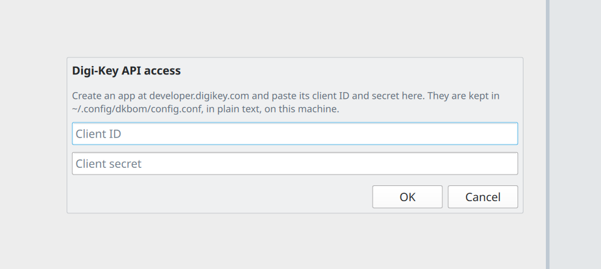
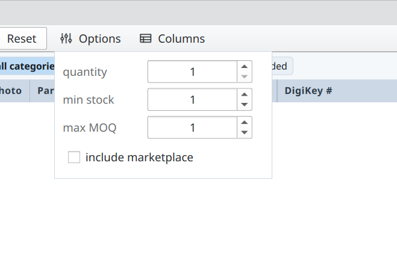
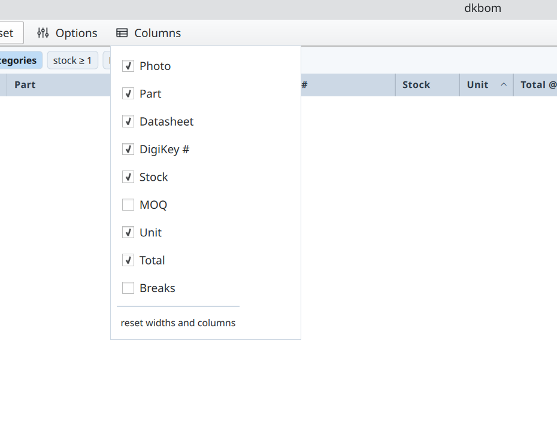

#  dkbom

[](LICENSE)
[](https://www.qt.io/)

dkbom is a desktop catalogue browser for Digi-Key. It integrates with KiCad to
assign parts to schematic symbols, keeping the catalogue and the project BOM
side by side.

Narrowing a category takes a few keystrokes. Pick a category, then type values
into a single box: `4.7k`, `0.1%`, `0603`, `25ppm`, `1/10`. The box matches every
filter in that category while you type, labels each hit with its filter, and
stages each pick locally. Press Apply once and the whole set goes to Digi-Key in
one request.


## What it does

- Browse the Digi-Key catalogue by category or keyword.
- Narrow a category with one filter box: type `4.7k`, `0.1%`, `0603`, `25ppm`,
  `1/10`, and pick from every matching filter at once.
- See stock, price breaks, MOQ, photos, and datasheet links for each part.
- Open a KiCad project and read its BOM through `kicad-cli`.
- Assign a Digi-Key number to a BOM line, then write it into every matching
  symbol in the schematic.
- Price the whole BOM for one board or for a production run.
- Keep a local response cache and a rate limiter in front of the Digi-Key
  quota.

## Requirements

- Linux. The code is portable Qt, but the packaging here targets Linux.
- Qt 6.5 or newer: Quick, QuickControls2, QuickDialogs2, Network, Svg.
- Qt Test, for the test suite.
- CMake 3.21+, Ninja, and a C++20 compiler.
- KiCad 10 with `kicad-cli` on `PATH` to open a project.
- A Digi-Key API app with Product Information V4 (product search) access.

## Install

```bash
git clone https://github.com/benjcal/dkbom.git
cd dkbom
make
sudo make install
```

Start it with `dkbom`, or open **dkbom** from your application menu.

To remove the installed files:

```bash
sudo make uninstall
```

## Using it

### Digi-Key API key

Create an app at [developer.digikey.com](https://developer.digikey.com/) with
**Product Information V4** access.

Open **Settings** (the gear icon) and paste the client ID and secret. They are
stored in `~/.config/dkbom/config.conf` as plain text on your machine. Saved
settings take priority over the environment.



### Browse and copy

The catalogue works without a KiCad project. Pick a category, then narrow it
with the filter box.

1. Pick a category in the filter panel.
2. Click **find any filter value** and type a value such as `4.7k`, `0.1%`,
   `0603`, `25ppm`, or `1/10`. Pick the matching filter from the list.
3. Repeat for the rest of the values. Each pick is staged; the Apply button
   counts them.
4. Press **Apply** to send the whole set to Digi-Key.
5. Hover a row to copy the MPN or Digi-Key number, or open the datasheet.


### Assign to KiCad

Opening a project is optional; browsing and copying work on their own. With a
project open, dkbom adds or updates a `DigiKey #` property on the symbol and
sets its value to the selected part number.

1. Press **Open project** and pick a `.kicad_pro`, the root `.kicad_sch`, or the
   project folder.
2. Select a BOM line on the right, pick a part in the results, and press
   **Assign**. The number is staged; the schematic stays untouched.
3. Press **Save** to write the property into every symbol on that line.
   **Undo** restores the previous values.
4. Press **Reload** after KiCad changes the project on disk.


### Options and columns

The **Options** popup sets the quantity used for pricing, the minimum stock, the
maximum MOQ, and whether marketplace parts are included.



The **Columns** popup chooses which columns the results table shows.



## Development

`make run` builds and starts the app. It sources `.env` when the file exists:

```bash
cp .env.example .env
$EDITOR .env
make run
```

## Tests

```bash
make test
```

The unit tests cover the schematic reader and writer, the CSV parser, the BOM
model, and pricing. The integration tests drive the checked-in project under
`tests/fixtures/project` through `kicad-cli`. They skip when `kicad-cli` is
missing.

## Limits

- Digi-Key's API has a daily quota. The cache and the limiter stretch it, but a
  busy session can still spend it.
- Search and pricing use the US site and USD.
- Schematic writes are tested with KiCad 10.
- Linux packaging only: a `.desktop` file and an icon. There is no Flatpak,
  AppImage, Windows, or macOS package yet.

## Credits

- [Qt 6](https://www.qt.io/) for the UI and the network stack. Qt is available
  under LGPLv3, GPLv3, or a commercial license.
- [Phosphor Icons](https://phosphoricons.com/) for the icon set, MIT licensed.
- [Digi-Key](https://www.digikey.com/) for the product API.
- [KiCad](https://www.kicad.org/) for `kicad-cli` and the schematic format.

See [NOTICE](NOTICE) for the license notices.

## Disclaimer

This project has no affiliation with and no endorsement from Digi-Key
Electronics or the KiCad project. Digi-Key and KiCad are trademarks of their
respective owners.

## License

[MIT](LICENSE)
