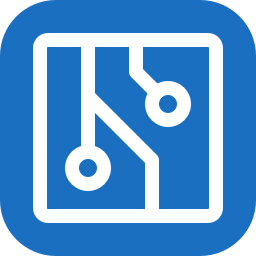
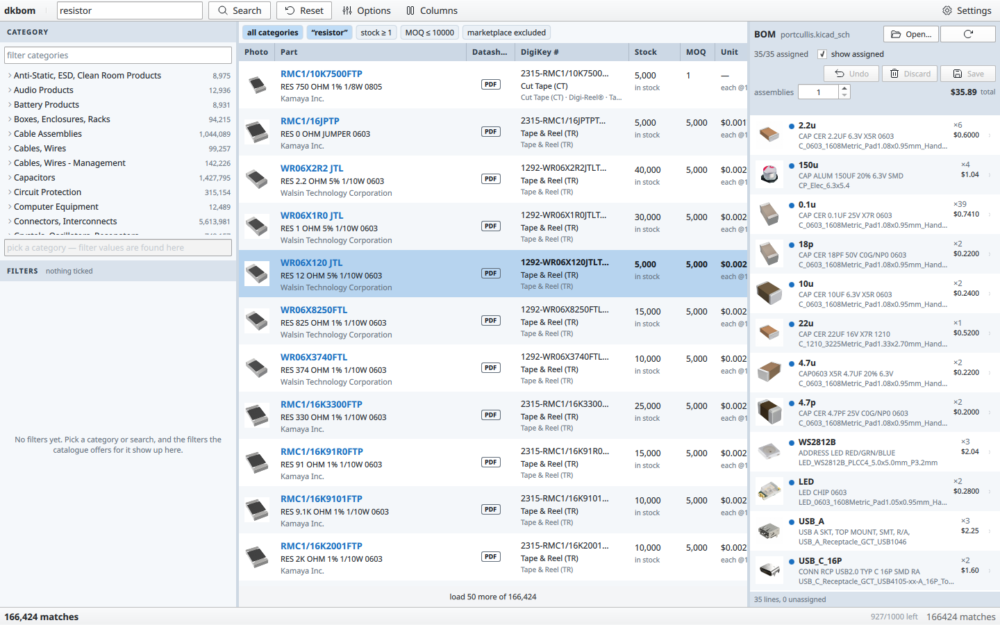
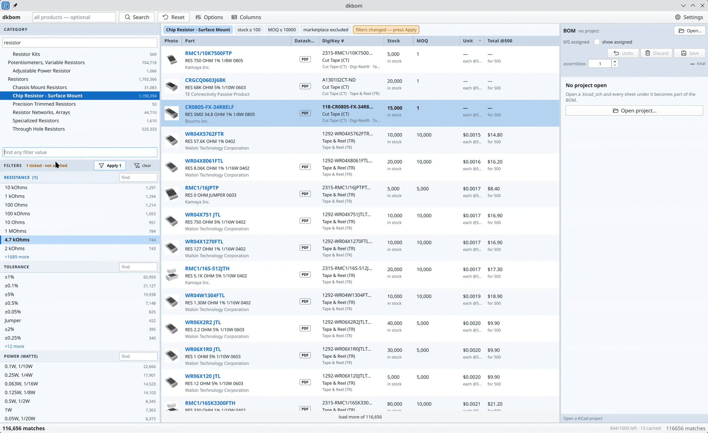
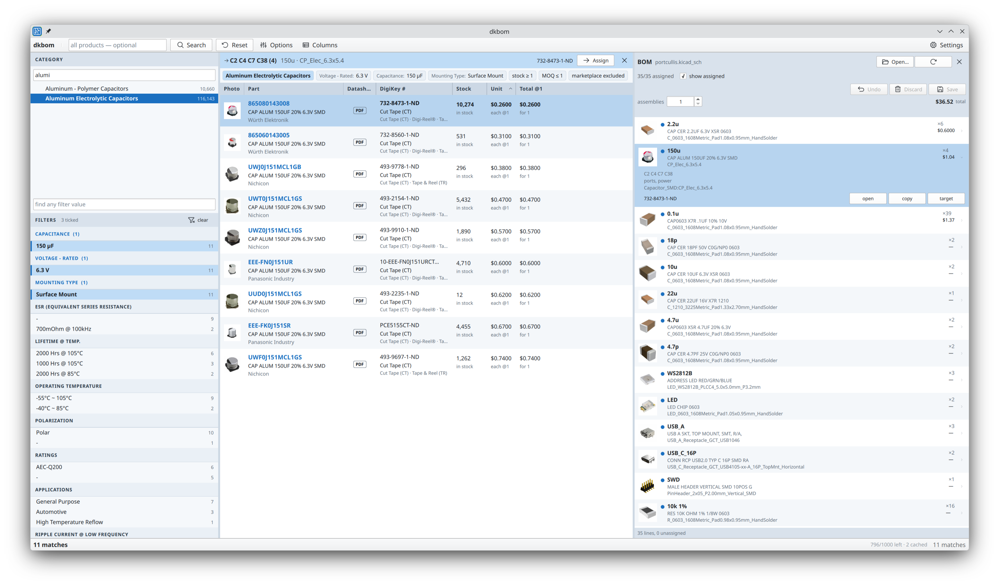

#  dkbom

[](LICENSE)
[](https://www.qt.io/)

dkbom is a desktop catalogue browser for Digi-Key. It integrates with KiCad to
assign parts to schematic symbols, keeping the catalogue and the project BOM
side by side.

Narrowing a category takes a few keystrokes. Pick a category, then type values
into a single box: `4.7k`, `0.1%`, `0603`, `25ppm`, `1/10`. The box matches every
filter in that category while you type, labels each hit with its filter, and
stages each pick locally. Press Apply once and the whole set goes to Digi-Key in
one request.



## Filter values by typing

Pick a category, then type the values you care about: `4.7k`, `0.1%`, `0603`,
`25ppm`, `1/10`. The box matches every filter in that category and labels each
hit with the filter it belongs to, so you can pick the right one when several
filters contain similar text. Each pick is staged; the Apply button counts them,
and the whole set goes to Digi-Key in one request.



## What it does

- Browse the Digi-Key catalogue by category or keyword.
- Narrow a category with one filter box: type `4.7k`, `0.1%`, `0603`, `25ppm`,
  `1/10`, and pick from every matching filter at once.
- See stock, price breaks, MOQ, photos, and datasheet links for each part.
- Open a KiCad project and read its BOM through `kicad-cli`.
- Assign a Digi-Key number to a BOM line, then write it into every matching
  symbol in the schematic.
- Price the whole BOM for one board or for a production run.
- Keep a local response cache and a rate limiter in front of the Digi-Key
  quota.

## Requirements

- Linux. The code is portable Qt, but the packaging here targets Linux.
- Qt 6.5 or newer: Quick, QuickControls2, QuickDialogs2, Network, Svg, Test.
- CMake 3.21+, Ninja, and a C++20 compiler.
- KiCad 10 with `kicad-cli` on `PATH` to open a project.
- A Digi-Key API app with Product Information V4 access. Create one at
  [developer.digikey.com](https://developer.digikey.com/).

## Build and run

```bash
make
make run
```

The same thing with CMake directly:

```bash
cmake -S . -B build -G Ninja -DCMAKE_BUILD_TYPE=Release
cmake --build build
./build/dkbom
```

Install and uninstall:

```bash
make install PREFIX=$HOME/.local
make uninstall
```

## Digi-Key credentials

The app reads `DIGIKEY_CLIENT_ID` and `DIGIKEY_CLIENT_SECRET` from the
environment. `make run` sources `.env` first, so development works like this:

```bash
cp .env.example .env
$EDITOR .env
make run
```

`.env` is gitignored. Keep it that way, and keep real credentials out of the
repository.

You can also paste the client ID and secret into the Settings dialog. They are
stored in `~/.config/dkbom/config.conf` as plain text, on your machine. Saved
settings take priority over the environment.

## Using it

1. Press **Open project** and pick a `.kicad_pro`, the root `.kicad_sch`, or the
   project folder.
2. Search for a part, pick a category, or tick filters in the rail. Press
   **Apply** to send the filters.
3. Select a BOM line on the right, pick a part in the results, and press
   **Assign**. The number is staged; the schematic stays untouched.
4. Press **Save** to write the Digi-Key number into every symbol on that line.
   **Undo** restores the bytes from before the write.
5. Press **Reload** after KiCad changes the project on disk.



## Tests

```bash
make build
ctest --test-dir build --output-on-failure
```

The unit tests cover the schematic reader and writer, the CSV parser, the BOM
model, and pricing. The integration tests drive the checked-in project under
`tests/fixtures/project` through `kicad-cli`. They skip when `kicad-cli` is
missing.

## Limits

- Digi-Key's API has a daily quota. The cache and the limiter stretch it, but a
  busy session can still spend it.
- Search and pricing use the US site and USD.
- Schematic writes are tested with KiCad 10.
- Credentials live in a plain-text config file. This is a bench tool, and that
  is the trade-off.
- Linux packaging only: a `.desktop` file and an icon. There is no Flatpak,
  AppImage, Windows, or macOS package yet.

## Credits

- [Qt 6](https://www.qt.io/) for the UI and the network stack. Qt is available
  under LGPLv3, GPLv3, or a commercial license.
- [Phosphor Icons](https://phosphoricons.com/) for the icon set, MIT licensed.
- [Digi-Key](https://www.digikey.com/) for the product API.
- [KiCad](https://www.kicad.org/) for `kicad-cli` and the schematic format.

See [NOTICE](NOTICE) for the license notices.

## Disclaimer

This project has no affiliation with and no endorsement from Digi-Key
Electronics or the KiCad project. Digi-Key and KiCad are trademarks of their
respective owners.

## License

[MIT](LICENSE)
